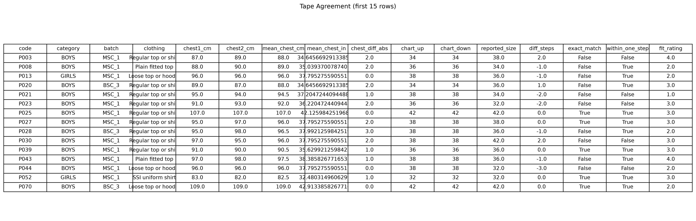
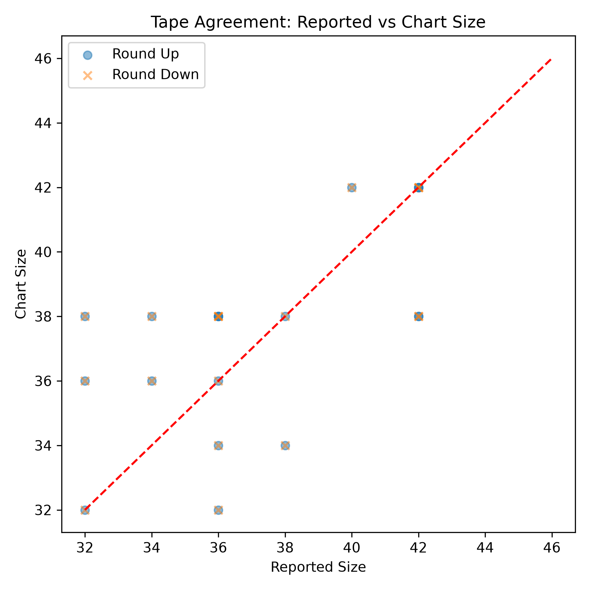
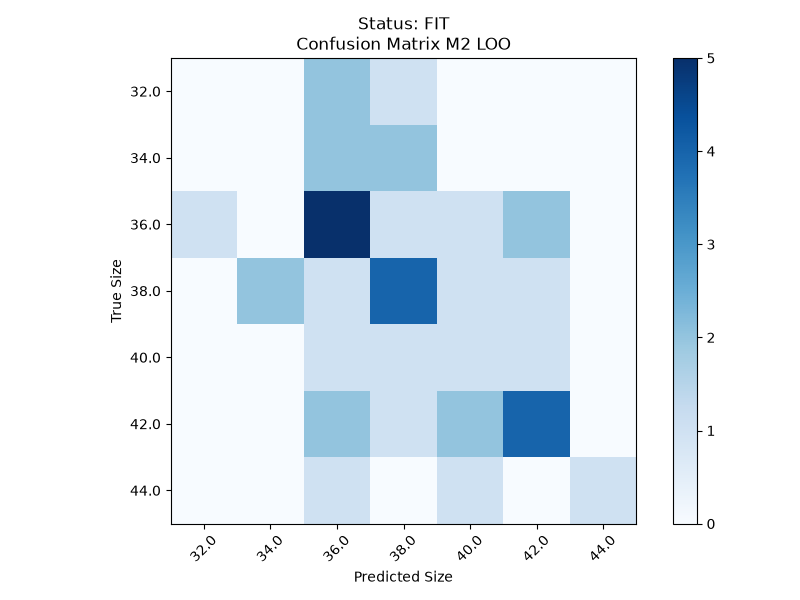
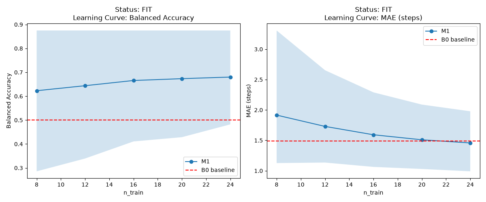

# 1. Title Page
**Project Title**: School Uniform Sizing and Measurement
**Organization**: Symbiosis Statistical Institute - Symbiosis International (Deemed University)
**Address**: Vishwabhavan Campus 3rd Floor, SCHC Building, Senapati Bapat Rd, Pune, Maharashtra 411004
**Submitted by**: <<FILL NAME>>, <<FILL PRN>>, <<FILL EMAIL>>
**Degree**: M.Sc. (Applied Statistics & Data Science)
**Academic Year**: 2025 - 2026
**Guide**: Dr. Madhulika Mishra, Assistant Professor, madhulika.mishra@ssi.edu.in

# 2. Acknowledgement
<<WRITE>> (150 to 200 words)

# 3. Introduction and Objective of the Survey
## Introduction
<<WRITE>> (200 to 250 words)

## Objective of the Survey
- **Main Objective**: Predict accurate school uniform sizes for students using morphological features extracted from photographs.
- **Specific Objectives**:
  - Extract morphological features (shoulder width, chest width, etc.) using MediaPipe Pose estimation.
  - Evaluate the reliability of self-measured tape dimensions against the official sizing chart.
  - Examine sample size requirements and the impact of different sampling designs (SRSWOR vs. Stratified) on coverage and error rates.

# 4. Sampling Design
Population: Symbiosis Statistical Institute MSc Statistics students
Sampling unit: one student
Sampling frame: the batch-wise student lists
Method: stratified, strata = category, SRSWOR within strata, reserve list used in pre-drawn order

Population N: 257 (Boys 132, Girls 125)
Sample n (consented): 69 (Boys 43, Girls 26)
Sampling fraction f: Boys 32.6%, Girls 20.8%

**Why it suits the survey**: The stratified approach ensures adequate representation of both Boys and Girls (as sizing charts differ strictly by category). SRSWOR provides unbiased estimates within these strata, and the reserve list handles non-response while maintaining randomization.

**Sample Size**: Total $n = 69$ (Target was at least 50 to 60).
**Reserve List Rule**: Replacements were drawn from the reserve list in pre-drawn randomized order.

### Sampling Summary Table
| Metric | Value | CI_low | CI_high |
|---|---|---|---|
| Refusal Rate | 0.1153846153846153 | 0.0619051062553332 | 0.2049701319848162 |
| Response Rate | 0.8846153846153846 | 0.7950298680151837 | 0.9380948937446668 |
| Reserve Share | 0.4492753623188406 | 0.3376885562924371 | 0.5662123249731189 |
| Kish deff_w | 1.0511254979532023 | nan | nan |
| Effective n | 65.64392180986935 | nan | nan |
| Implied Margin | 10.110216887250555 | nan | nan |

<<WRITE INTERPRETATION>>

# 5. Questionnaire Design
The questionnaire comprises 15 items designed for clarity and logical flow:
1. **A1**: Timestamp
2. **A2**: Category (Boys/Girls)
3. **A3**: Age / Consent
4. **A4**: PRN (Removed for privacy)
5. **A5**: Email
6. **Q1**: Height (cm)
7. **Q2**: Reported Size
8. **Q3**: Fit Rating
9. **Q4**: Current Clothing
10. **Q5**: Batch
11. **Q6**: Chest Measurement 1 (cm)
12. **Q7**: Chest Measurement 2 (cm)
13. **Q8**: Shoulders (cm)
14. **Q9**: Photo Upload
15. **Q10**: Feedback / Notes

*Note: The questions logically progress from consent to demographics, followed by size and fit assessment, and finally physical measurements and photo upload. The full questionnaire is provided in the Appendix.*

# 6. Data Collection
- **Dates**: Offline station sessions conducted on 1, 5, and 6 October 2026.
- **Operators**: Field investigators taking photographs and assisting with tape measurements.
- **Outcomes**: Consented $n=69$.

### Practical Difficulties
<<WRITE>>

# 7. Data Analysis, Visualization and Interpretation

## 7.1 Tape Agreement (S10)

<<WRITE INTERPRETATION>>

<<WRITE INTERPRETATION>>

## 7.2 Modeling Boys (S7)

<<WRITE INTERPRETATION>>

## 7.3 Experiments and Simulations (S11)

<<WRITE INTERPRETATION>>

# 8. Result
<<WRITE>>

# 9. Challenges Faced and Future Scope
## Challenges Faced
<<WRITE>> (at least 100 words)

## Future Scope
<<WRITE>> (at least 100 words)

# 10. Bibliography
1. Cochran, W. G. (1977). *Sampling Techniques* (3rd ed.). John Wiley & Sons.
2. Lohr, S. L. (2019). *Sampling: Design and Analysis* (3rd ed.). CRC Press.
3. MediaPipe Developers. (2023). *MediaPipe Pose*. Google.
4. scikit-learn developers. (2023). *scikit-learn: Machine Learning in Python*.
5. Singh, D., & Chaudhary, F. S. (2003). *Theory and Analysis of Sample Survey Designs*. New Age International.

# 11. Appendix
## Questionnaire
(Full questionnaire text provided separately)

## Sample Questionnaires (Filled)
| timestamp | code | filled_by | session | how_in | consent | category | batch | height_cm | size_reported | fit_rating | clothing | chest1_cm | chest2_cm | notes | consented | refused | under18 | mode | is_pilot | how_in_short | session_date |
|---|---|---|---|---|---|---|---|---|---|---|---|---|---|---|---|---|---|---|---|---|---|
| 2026-10-01 14:16:08.107 | P001 | Ayush | 1st October | On the random list (primary) | Yes: agrees AND is 18 or over | BOYS | MSC_1 | 175.0 | 38.0 | 3.0 | Regular top or shirt | nan | nan | nan | True | False | False | station | False | primary | 2026-10-01 |
| 2026-10-01 14:19:35.049 | P002 | Kapil | 1st October | On the random list (primary) | Yes: agrees AND is 18 or over | BOYS | MSC_1 | 168.0 | 32.0 | 3.0 | Regular top or shirt | nan | nan | nan | True | False | False | station | False | primary | 2026-10-01 |
| 2026-10-01 14:23:44.554 | P003 | Kapil | 1st October | On the random list (primary) | Yes: agrees AND is 18 or over | BOYS | MSC_1 | 171.0 | 38.0 | 4.0 | Regular top or shirt | 87.0 | 89.0 | nan | True | False | False | station | False | primary | 2026-10-01 |

## Codebook & Draw Log
(Provided in accompanying data files)
